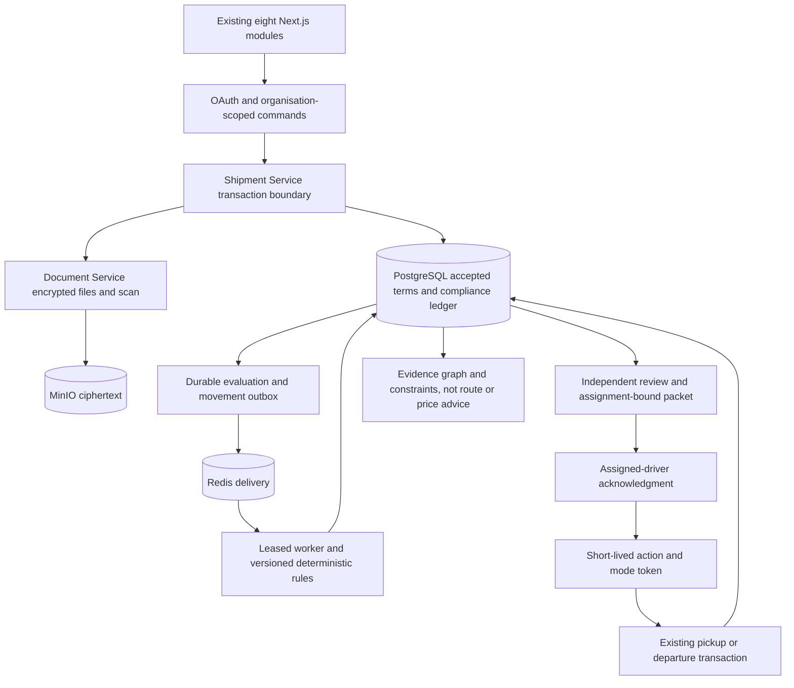

# Guarded Dispatch Phase 4

Phase 4 adds deterministic India domestic applicability, independent evidence review,
and **Platform dispatch authorisation** to commercial consignments. It is not government
clearance, a tax-rate opinion, an IRN/EWB issuer, or professional legal advice.
Earlier prototype Compliance Service assessments cannot authorise this workflow.

## Scope

`INDIA_ORDINARY_ROAD_V1` covers ordinary taxable interstate SALE, INR, ROAD,
registered REGULAR parties, NORMAL establishments and REGULAR layout. It requires
one complete invoice per consignment, complete loaded quantities, a current accepted
vehicle/driver/carrier, and published commodity and complete state-corridor coverage.
The seeded corridor is Karnataka 29 to Tamil Nadu 33, with no intermediate states.

Unknown facts block. Job work, special handicraft treatment, split invoices, special/RSP
valuation, reverse charge, SEZ, hazmat, cold chain, over-dimensional cargo and unknown
permit restrictions cannot be waived into READY. Classification and tax rates remain
NOT_ASSESSED. Cotton shirts and 18 percent tax are synthetic fixture assumptions.

## Implemented Features

- Bounded typed three-valued expressions; integer paise and Decimal quantities.
- Immutable hashed source snapshots, interpretations, dated rules/packs, registered
  tests, independent publication, suspension and material-source conflict handling.
- AES-GCM encrypted seller PAN/FY declarations and protected private source records.
  HSN uses the immediately preceding FY independently of the historical e-invoice test.
- Exact reviewed source/fact/mapping bindings, loading manifests, invoice reservations,
  typed transport evidence, current authorised observations and permitted manual proof.
- Durable evaluation jobs and outbox/Redis delivery with PostgreSQL leases and stale-job rejection.
- Findings, corrective cases, independent declaration/release decisions and integrity holds.
  Buyer recipient confirmations do not rewrite accepted commercial terms.
- Assignment-bound carried-document packets, short-lived encrypted file grants, assigned-driver
  possession acknowledgments and distinct pickup/departure authorisations.
- Atomic consumption with existing movement/audit/payment effects and retryable projections.
  Token issuance alone never represents movement or triggers a dispatch payment milestone.
- Permission-filtered evidence graphs/manifests, current constraints, distinct legal-expiry
  and policy-freshness deadlines, and non-retroactive post-departure alerts.
- Existing eight modules retained; carrier controls are on the assignment page and drivers
  use their mobile task. There is no ninth top-level module.

## Simulation and Production

Simulation follows the same gate. Seeded authority statuses and signature records are
explicitly synthetic. Generated PDFs are real encrypted files and pass the Document
Service scan boundary. Browser tests use local encrypted storage and an isolated ClamAV
protocol fixture; they do not certify a real production antivirus or MinIO deployment.

Production has no automatically published pack. The catalog at `data/regulations/phase4`
contains pinned official PDFs and interpretation limitations. The dated 2021 rules
compilation is UNKNOWN, so it cannot silently establish current law. A candidate stays
UNPUBLISHED until legal coverage/current sources are independently reviewed and the exact
pack is tested, approved and published. A URL is not fetched or treated as proof that the
uploaded bytes actually came from the authority.

Production rejects SIMULATION/SANDBOX provider results. LIVE proof requires a configured
server-managed authorised connection and exact matching observation.
`AUTHORISED_LIVE_ONLY` rejects manual evidence; a published
`AUTHORISED_LIVE_OR_REVIEWED_MANUAL` policy can accept independently reviewed structured
portal observations with clean supporting evidence. They remain MANUAL_REPORTED, never
live API responses. Outages and missing authorisation remain UNKNOWN.

Original reviewed transport records are supported. A live transport lookup provider and
PDF signature trust/revocation verification are not implemented. Future work includes
broader reviewed scope, live provider contracts, central publisher provisioning, offline
synchronisation and external WORM/KMS audit hardening. Phase 4 adds no route/price optimiser,
freight bids, news scoring, advanced OCR, LLM decisions or government filing.

## Architecture



The ledger shares Shipment Service's agreement/operation/document metadata transaction,
so the gate cannot partially commit a movement and leave its authorisation unused.
Document Service owns encrypted bytes. Packet callbacks recheck current grants; the
initial download request does not hold a write lock across that HTTP callback.

Relevant writes lock the registry before trade/resource rows. Publication takes the
exclusive registry lock. Workflow approvals, packets, ACKs and tokens do not invalidate
their own factual evaluation. Accepted amendments, sources/security, observations,
manifests, declarations, holds, recipient corrections and assignment/vehicle changes do.
Consumption checks live permissions and trusted server time, not backdated `occurred_at`.

Completed decisions have database immutability guards. `decision_manifest` and its hash
exclude later workflow/freshness; the outer manifest has a separate current-status hash.
Shared exports omit seller PAN/history, private identity files, raw private responses
and provider credentials. Referencing evidence never grants access to its original file.

## Setup and Migration

Stop the application and take consistent PostgreSQL, MinIO and keyring backups before
upgrading real data. Restore-test in isolation. Never use `docker compose down -v` to
upgrade or roll back.

```powershell
python scripts/init-document-key.py
docker compose config --quiet
docker compose up -d --build shipment-service document-service document-worker web api
```

These are deployment instructions; implementation tests leave the main deployment stopped.
Startup upgrades `trade_003` to `trade_004`: additive tables/immutability guards,
historical-movement flag, and nullable document-version/trade job references. Existing
agreements, receipts, inspections and payments remain intact. Legacy movement gets a
notice rather than fabricated approvals; arrival/receiving can continue, but new
pickup/departure always needs the gate.

Shipment Service, worker and Document Service share the keyring through existing Docker
secret mounts. Restrict host access, keep retired decryption keys for retained files,
back up keys separately and never commit them. Ciphertext alone is not recoverable.

Destructive Alembic downgrade is refused. Restore the verified pre-upgrade database,
objects and keyring with matching application images in an isolated recovery deployment.
Do not run an old ungated binary against current production data. Verify migration
revision, source hashes/decryption, OAuth/roles, worker health, registry manifest,
historical records and movement rejection tests after recovery.

## Demo Runbook

Use a dedicated development deployment. Set `OPERATIONAL_DEMO_ENABLED=true` and
`DOCUMENT_DEMO_ENABLED=true` in its `.env`, then recreate relevant services so Document
Service sees the flag. ClamAV must be healthy; unscanned/quarantined files never enable release.

```powershell
docker compose exec shipment-service python -m app.compliance.cli --namespace review4 --scenario missing-ewb
```

Use distinct existing OAuth identities for seller preparer/reviewer, carrier dispatcher,
carrier evidence reviewer and driver. `--identity-map` accepts a private role-to-profile
JSON file. Unmapped synthetic profile IDs are fixture records, not public credentials or
an authentication bypass. Use fresh namespaces to preserve history.

1. Open `/trades` and the seeded commercial operations workspace. Seller reviews accepted
   facts, the complete manifest and exact source versions; evaluate pickup to show the EWB blocker.
2. Upload/review a wrong-vehicle EWB in Documents, bind its exact version/proof and evaluate.
   EWB_IDENTITY shows expected/observed vehicle; no independent reviewer can waive it.
3. Correct/replace and review that source, refresh proof, rebind and reevaluate. A different
   seller reviewer approves the current evaluation hash.
4. Carrier dispatcher opens the consignment assignment and prepares the invoice/EWB packet.
   Assigned driver downloads the permitted copy, confirms possession and acknowledges its hash.
5. Request pickup authorisation and execute the exact manifest. Replay returns the original
   event; a different command cannot reuse the token.
6. Departure requires a new evaluation, approval, packet, ACK and token. Expired tokens fail
   even with backdated events. Refresh/rebind expired observations to obtain a new chain.
   Clock advancement exists only in tests, never a public API.
7. Execute departure and show unchanged receipt/payment meanings, source/rule/fact/proof
   traces, consumed authorisation, immutable manifest and current constraint snapshot.
8. Show post-departure expiry/adverse-proof alerts without rewriting the historical decision.
   In Regulations show the production candidate as unpublished, with explicit limitations.

`matching` and `wrong-vehicle` seed variants provide separate comparisons. To create an
unpublished official-source candidate, add `--source-folder data/regulations/phase4` when
running the CLI locally with the same development database/keyring/storage configuration,
or provide an explicit read-only catalog mount for the container. The current image does
not automatically mount that directory. The candidate is never auto-published.

## APIs and Contracts

Endpoints use `/api/v1` on Shipment Service through the existing web gateway. Supply OAuth
session/bearer authentication and `X-Organization-Id`. Writes require `Idempotency-Key`;
context mutations also need current quoted `If-Match` and `expected_context_version`.
Retry the same logical command with the same key, never a different body. Poll HTTP 202
evaluation jobs before review. 409 indicates state conflict, 412 stale context, 422 input
validation and 503 unavailable storage.

See [OpenAPI](postman/guarded-dispatch.openapi.json), versioned schemas in `docs/postman`,
[Postman collection](postman/guarded-dispatch.postman_collection.json) and the
[blank local environment](postman/guarded-dispatch.local.postman_environment.json).
Bodies are placeholders to populate from actual reviewed records, not release defaults.

```powershell
python scripts/export-dispatch-contracts.py
postman collection run docs/postman/guarded-dispatch.postman_collection.json -e <private-local-environment.json> -i "Read-only smoke" --no-report-events --bail
```

Never upload populated environments, credentials or private business records to shared
Postman workspaces. The optional browser/Postman check uses disposable profile tokens,
disables reporting and deletes its temporary credential environment.

## Tests and Limits

Build `apps/web` before browser checks. Run the backend suite, architecture checks and
`python scripts/dispatch-browser-check.py`. Set `TRADE_TEST_DATABASE_URL` only to disposable
PostgreSQL; race tests use random schemas and remove only their own schemas. Browser
checks own temporary services/port 3133 and refuse to replace an existing server.
CI includes PostgreSQL Phase 4 tests, contract-drift checks and authenticated browser acceptance.

AES-GCM protects storage, not a compromised authorised application/database administrator.
SQL triggers are not externally anchored WORM attestation. Use HTTPS, managed KMS/HSM,
trusted publisher provisioning, retention/deletion controls, external audit sinks,
penetration testing and recovery exercises before commercial deployment. Revocation stops
future downloads, not previously saved copies. Offline possession is not offline movement
permission: authorisation consumption needs online validation.

Tests establish reproducible behaviour in the supported profile, not universal legal
accuracy. No live-law completeness, confidential government outcomes or lowest transport
price is claimed. The [deployment verification report](phase4-deployment-verification.md)
records checked paths and remaining gaps.
